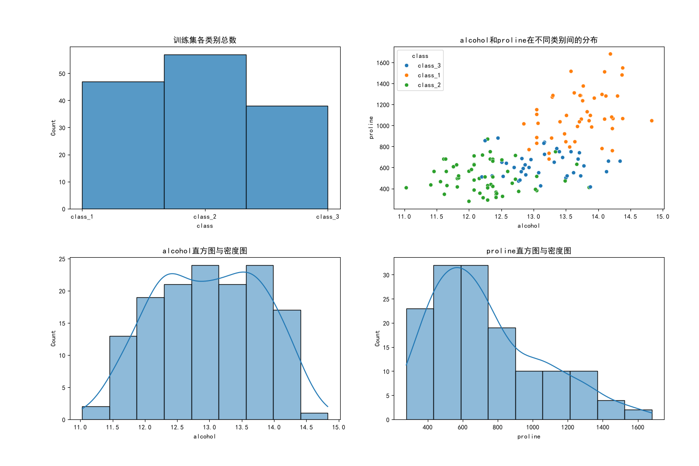
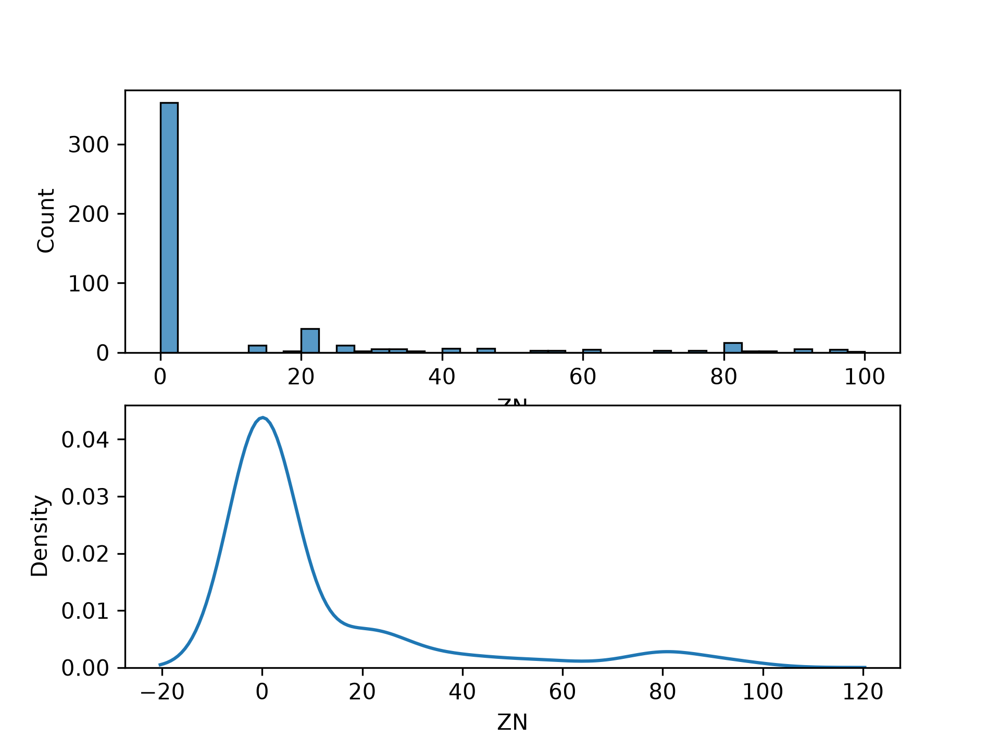
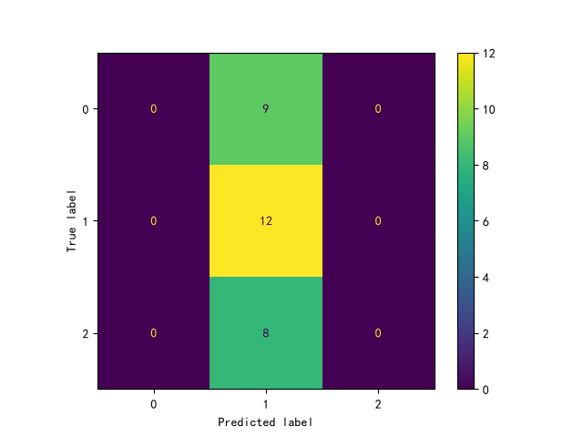
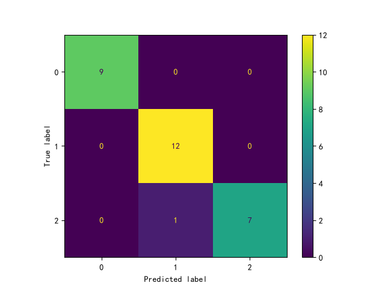

# ML Foundation

一个记录机器学习基础学习过程的 Python 项目，内容涵盖 NumPy 数组运算与梯度下降、Pandas 数据探索、训练集划分、分类基线与决策树复杂度对照、单模型及四方案五折交叉验证、折外预测，以及 Seaborn/Matplotlib 可视化。

## 学习进度（更新至2026-11-04）

### Wine 数据集探索

`scr/train.py` 当前会：

- 加载 scikit-learn 内置 Wine 数据集，并检查字段类型和缺失值；
- 将三个数字目标映射为 `class_1`、`class_2`、`class_3`；
- 使用 `stratify=Y` 和随机种子 `2026`，按 8:2 分层划分开发数据和最终测试数据，并断言两者索引没有重叠；
- 将 142 条开发数据再次按 8:2 分层划分为 113 条拟合数据和 29 条验证数据；最终测试集保留 36 条数据；
- 仅使用142条开发数据绘制类别数量、`alcohol` 与 `proline` 分类散点图，以及两个特征的直方图和核密度图，最终测试数据不参与探索；
- 将图表保存至 `reports/wine数据集探索/wine数据集探索.png`。

脚本已拆分为 `load_data()`、`split_data()`、`plot_eda()` 和 `main()`，只有直接运行文件时才会执行完整流程。初步观察：三个类别数量较均衡；`proline` 呈偏态分布；类别之间存在重叠，但 `alcohol` 与 `proline` 仍表现出一定区分度。

### Wine 分类基线

`scr/baseline.py` 复用 Wine 数据加载与划分逻辑，并在 113 条拟合数据上训练、在 29 条验证数据上比较：

- 使用 `strategy="most_frequent"` 的 `DummyClassifier` 作为最低基线；
- 使用 `StandardScaler` 和 `LogisticRegression(max_iter=1000)` 组成流水线（Pipeline），确保标准化只在拟合数据上学习；
- 计算准确率（Accuracy）、宏平均 F1（Macro F1）和混淆矩阵；
- 将汇总指标写入 `reports/baseline/metrics.csv`，逐条验证预测及按 `classes_` 排列的类别概率写入 `reports/baseline/validation_predictions.csv`；
- 将两个模型的混淆矩阵保存为 `reports/baseline/cm_dum.png` 和 `reports/baseline/cm_log.png`。

当前验证结果如下（固定随机种子下）：

| 模型 | 验证样本数 | Accuracy | Macro F1 |
| --- | ---: | ---: | ---: |
| Dummy | 29 | 0.4138 | 0.1951 |
| Logistic Regression | 29 | 0.9655 | 0.9644 |

以上仅为开发阶段验证集结果，当时36条最终测试保留；冻结方案后的最终评估单独记录在下文。

`scr/baseline_review.py` 是独立复现练习，自行组织读取、两次分层划分和模型函数，沿用相同配置，预测与指标均与原基线一致。该练习的两张混淆矩阵保存到 `reports/baseline/baseline_review/`。

### Wine 决策树入门

`scr/tree_baseline.py`直接复用`train.py`的读取与固定划分，只在113行拟合数据上训练一棵`DecisionTreeClassifier(max_depth=3, random_state=2026)`。分别评价拟合与验证数据，36行最终测试继续保留。

| 数据部分 | 样本数 | Accuracy | Macro F1 |
| --- | ---: | ---: | ---: |
| fit | 113 | 0.9912 | 0.9919 |
| validation | 29 | 0.9310 | 0.9274 |

两行指标保存到`reports/decision_tree/metrics.csv`，真实特征名称的文本规则保存到`reports/decision_tree/tree_rules.txt`。控制台还输出实际树深度、叶节点数和一个拟合样本的特征及预测，供手工核对分类路径。以上是固定配置、单次划分的结果，不据此判断稳定泛化优势。

### Wine 四方案统一比较

[scr/compare_models.py](scr/compare_models.py)复用`train.py`的两次分层划分，固定13个特征及随机种子2026。四个方案各在113条数据上拟合一次，再复用同一个模型分别评价113条拟合数据和29条验证数据；逻辑回归的Scaler只在113条拟合数据上学习参数。

| 方案 | 固定配置 | 拟合Accuracy | 拟合Macro F1 | 验证Accuracy | 验证Macro F1 |
| --- | --- | ---: | ---: | ---: | ---: |
| Dummy | `strategy="most_frequent"` | 0.3982 | 0.1899 | 0.4138 | 0.1951 |
| LogisticRegression | StandardScaler＋`max_iter=1000` | 1.0000 | 1.0000 | 0.9655 | 0.9644 |
| Tree_depth3 | `max_depth=3, random_state=2026` | 0.9912 | 0.9919 | 0.9310 | 0.9274 |
| Tree_unrestricted | `max_depth=None, random_state=2026` | 1.0000 | 1.0000 | 1.0000 | 1.0000 |

深度3树的实际深度为3、叶节点数为6；不限深度树的实际深度为4、叶节点数为7。Accuracy和Macro F1采用统一计算方式，Macro F1显式使用类别`[0,1,2]`。

脚本输出：

- [metrics.csv](reports/model_comparison/metrics.csv)：四方案的`fit/validation`各一行，共8行，包含模型名、数据部分、样本数和两个指标。
- [validation_predictions.csv](reports/model_comparison/validation_predictions.csv)：同一批29条验证记录，包含Wine原始`sample_index`、`y_true`及四列预测；样本顺序与验证数据一致。
- 控制台输出两棵树的结构、两张表和深度3树的混淆矩阵；矩阵行是真实类别、列是预测类别，顺序均为`[0,1,2]`，总数29，对角线之和27。

深度3树错分原索引43和141，逻辑回归错分134，不限深度树在这29条验证数据上全部正确。单条样本约改变3.45个百分点的验证Accuracy，当前排名仅适用于本次固定划分；验证分数1.0000不代表稳定泛化优势。

本节四方案比较没有使用36条最终测试，指标全部来自原113／29划分；单模型与四方案五折CV分别记录如下，不与本表混用，未进行参数搜索。

### Wine 单模型五折交叉验证

[scr/cv_baseline.py](scr/cv_baseline.py)使用142条开发数据和13个特征，对`StandardScaler`＋`LogisticRegression(max_iter=1000)`的整条Pipeline执行五折CV。固定`StratifiedKFold(n_splits=5, shuffle=True, random_state=2026)`，保存五组位置索引并交给`cross_validate`复用。

每折重新拟合Pipeline，Scaler只学习当轮训练折；前两折各有113条训练、29条验证，后三折各有114条训练、28条验证。只计算验证Accuracy与Macro F1，类别顺序明确为`[0,1,2]`，使用`n_jobs=1`、`return_train_score=False`和`error_score='raise'`。

输出[reports/cross_validation/fold_metrics.csv](reports/cross_validation/fold_metrics.csv)，共5行，列为`fold、n_fit、n_validation、accuracy、macro_f1`。控制台另输出五折分数、均值与标准差；以下为该单模型实验的CSV汇总，脚本已于2026年10月22日核验：

| 指标 | 五折均值 | 折间标准差（ddof=0） |
| --- | ---: | ---: |
| Accuracy | 0.9719 | 0.0259 |
| Macro F1 | 0.9721 | 0.0261 |

CV结果中的`test_accuracy`、`test_macro_f1`表示当轮验证折成绩，不是保留的36条最终测试成绩。五折均值与原29条固定验证分数的评价安排不同，不能直接按数值大小判断哪次更好；折间标准差也不能直接当作置信区间。

2026年10月22日已在独立源码副本的新Python进程中重跑，退出码0，生成的5行CSV与已提交报告一致；另经运行时核验确认开发集标签索引对齐、五轮验证位置恰好覆盖142条各一次、每折Pipeline及Scaler仅拟合对应训练折，36条最终测试未使用。单模型CV追加任务通过验收；本次验证使用现有ML环境，未验证全新机器环境重建。

### Wine 四方案同折CV与折外预测

[scr/cv_compare_models.py](scr/cv_compare_models.py)沿用上述四个固定配置，在相同142条开发数据、相同五组分层划分上比较。划分为`StratifiedKFold(n_splits=5, shuffle=True, random_state=2026)`，主指标为Macro-F1，Accuracy辅助；标准差使用`ddof=0`。

每个方案调用一次`cross_validate`，共拟合20个折模型。逻辑回归的Scaler只学习当轮训练折；通过`return_estimator=True`保留折模型，后续预测对应验证成员时直接复用。

| 方案 | Accuracy均值 | 折间标准差 | Macro-F1均值 | 折间标准差 |
| --- | ---: | ---: | ---: | ---: |
| Dummy | 0.4012 | 0.0103 | 0.1909 | 0.0035 |
| LogisticRegression | 0.9719 | 0.0259 | 0.9721 | 0.0261 |
| Tree_depth3 | 0.9296 | 0.0491 | 0.9312 | 0.0475 |
| Tree_unrestricted | 0.9153 | 0.0473 | 0.9185 | 0.0466 |

输出保存在`reports/cv_model_comparison/`：

- [fold_metrics.csv](reports/cv_model_comparison/fold_metrics.csv)：20行，每方案5折，含折号、训练／验证人数和两项分数。
- [summary.csv](reports/cv_model_comparison/summary.csv)：4行，含每方案的均值与总体标准差；逻辑回归五折结果复现原单模型实验。
- [oof_predictions.csv](reports/cv_model_comparison/oof_predictions.csv)：142行、7列，保留Wine原索引、验证折号、真实类别和四列预测，整行按开发集原顺序排列。每条预测来自未使用该样本训练的对应折模型。

控制台输出逻辑回归完整折外混淆矩阵，行是真实类别、列是预测类别，顺序均为`[0,1,2]`：

```text
[[46,  1,  0],
 [ 0, 55,  2],
 [ 0,  1, 37]]
```

矩阵合计142条，正确138条；整体折外Accuracy为0.9718。折外整体指标与五折分数均值的汇总方式不同，不能混为同一个数值。原索引134上两棵树正确、逻辑回归错误，150上相反，错误不完全重合。

本次CV将标准化逻辑回归作为候选；一次小数据五折排名不证明稳定优势，折间标准差不是置信区间。CV比较阶段没有使用最终36条。后续已于10月29日确认并冻结配置，最终评估见下一节。

2026年10月29日在独立源码副本的新Python进程中重跑并核验，退出码0；3张CSV的20／4／142行、统计及预测对应关系与现有报告一致。使用现有ML环境，未执行参数搜索、最终测试评分或全新机器环境重建。

### Wine 冻结方案的最终评估

[冻结记录](reports/final_evaluation/frozen_config.md)于10月29日在测试前填写，选定原标准化逻辑回归Pipeline。[scr/final_evaluate.py](scr/final_evaluate.py)新建同配置Pipeline，在全部142条开发数据上拟合一次，Scaler仅学习开发数据，再评价原36条最终测试。

| 方案 | 测试样本 | Accuracy | Macro-F1 |
|---|---:|---:|---:|
| StandardScaler＋LogisticRegression(max_iter=1000) | 36 | 0.9722 | 0.9743 |

输出：[metrics.csv](reports/final_evaluation/metrics.csv)共1行，[test_predictions.csv](reports/final_evaluation/test_predictions.csv)共36行，保留原测试顺序、原索引、真实标签与预测。固定类别顺序`[0,1,2]`核对的混淆矩阵为`[[12,0,0],[1,13,0],[0,0,10]]`，35条正确；唯一错误是原索引73，真实类别1、预测类别0。

10月31日对同一冻结方案在独立副本重跑，退出码0，两张CSV与已有报告一致；运行跟踪确认Pipeline和Scaler各拟合一次、训练样本数142。此次为复现核对，未调参、换种子或增加候选。脚本未显式指定评分类别顺序，本次三类均出现，按冻结的`[0,1,2]`独立重算结果一致。

CV用于选择方案，最终测试用于评价冻结方案，二者数据成员和训练安排不同。36条测试上的成绩不保证未来泛化表现，也不用于进一步选模型；没有设置最低分数要求。

### Boston Housing 数据探索

`exercises/exercises.py` 当前会：

- 输出 506 条观测、14 个字段的数据总览和描述性统计；
- 统计每列缺失值数量与占比，以及包含缺失值的行数；
- 使用 `value_counts(dropna=False)` 统计 `ZN`，保留缺失值计数；
- 筛选 `RM > 6` 的观测，并按 `CHAS` 分组计算 `MEDV` 均值；
- 统计并绘制 `ZN` 的直方图与核密度图；
- 将图表保存至 `reports/exercises/ZN频数统计.png`。

脚本已拆分为 `load_data()`、`na_count()`、`plot_data()` 和 `main()`。CSV 中的 `NA` 会被 Pandas 自动解析为缺失值。目前共有 112 行包含缺失值；`CRIM`、`ZN`、`INDUS`、`CHAS`、`AGE` 和 `LSTAT` 各缺失 20 个值（约 3.953%）。

### NumPy 数组练习

`exercises/数组练习.py` 使用矩阵乘法计算线性预测 `x @ w + b`，再计算预测值与真实值之间的均方误差（Mean Squared Error, MSE）。脚本还会：

- 检查数组形状，并通过 `axis=0` 和 `axis=1` 分别计算列均值和行均值；
- 对比元素乘法 `x * w` 与矩阵乘法 `x @ w`；
- 对比一维数组与列向量参与运算时的广播结果；
- 从零初始化权重和偏置，手动计算 MSE 梯度并完成一步梯度下降。

关键输出为：

```text
y_hat: [ 8 18 28] MSE: 2.0

x: (3, 2)
y: (3,)
w: (2,)
y_hat: (3,)
err: (3,)

x_mean_axis=0: [2. 3.]
x_mean_axis=1: [0.5 2.5 4.5]

更新前MSE： 382.0
权重梯度： [ -98.66666667 -133.33333333]
偏置梯度： -34.666666666666664
更新后参数： [0.98666667 1.33333333] 0.3466666666666666
更新后MSE： 149.1488
```

数组脚本默认学习率为 `0.01`，单步更新后MSE由382降至149.1488。相同数据、每次零初始化的实测对照中，学习率 `0.1` 时MSE由382升至2940.08，说明过大的步长可能使训练损失增加；这些单步结果不代表模型的泛化表现。

### NumPy 多步梯度下降与库模型对照

[exercises/gradient_descent_loop.py](exercises/gradient_descent_loop.py)沿用3条、2个特征的微型数据及标签`[7,16,29]`，从浮点零参数开始，以学习率`0.01`更新500次。每轮两组梯度由同一旧误差计算，更新参数后记录MSE；初始MSE为382，第1步为149.1488。

在相同数据和顺序上拟合一次`LinearRegression(fit_intercept=True)`，与NumPy模型使用相同训练MSE口径，不加标准化或正则化：

| 模型 | 训练样本数 | 训练MSE |
| --- | ---: | ---: |
| NumPy_GD（500步） | 3 | 0.88920076 |
| LinearRegression | 3 | 0.88888889 |

输出保存在`reports/gradient_descent/`：

- [loss_history.csv](reports/gradient_descent/loss_history.csv)：501行，步号0—500，包含初始及每次更新后的MSE。
- [prediction_comparison.csv](reports/gradient_descent/prediction_comparison.csv)：3行，包含原位置、真实值及两种预测。
- [metrics.csv](reports/gradient_descent/metrics.csv)：2行，包含模型名、样本数及训练MSE。

有限500步的预测与库结果接近，但不要求完全相同。两列特征满足`x[:,1]=x[:,0]+1`，加入截距后参数不唯一，因此比较预测和MSE，不要求权重、偏置逐项一致；训练损失下降也不证明泛化。

2026年11月4日在独立源码副本中，从项目根目录与另一工作目录分别启动新Python进程，退出码均为0；三张CSV均与现有报告一致，重算MSE正确，输出位置不随工作目录变化。本次使用现有ML环境，未重跑Wine实验。

> 当前项目已有单步及500步梯度下降、LinearRegression训练MSE对照、固定划分四方案比较、单模型及四方案同折CV、折外预测，以及冻结逻辑回归方案的最终测试结果；尚未配置自动化测试框架。

## 可视化结果

### Wine 数据集



### Boston Housing 的 ZN 分布



### Wine 分类基线混淆矩阵

| DummyClassifier | Logistic Regression |
| --- | --- |
|  |  |

## 项目结构

```text
ml-foundation/
├── data/
│   └── Boston Housing Data.csv
├── exercises/
│   ├── exercises.py
│   ├── gradient_descent_loop.py
│   └── 数组练习.py
├── reports/
│   ├── baseline/
│   │   ├── baseline_review/
│   │   │   ├── cm_dum.png
│   │   │   └── cm_log.png
│   │   ├── cm_dum.png
│   │   ├── cm_log.png
│   │   ├── metrics.csv
│   │   └── validation_predictions.csv
│   ├── cross_validation/
│   │   └── fold_metrics.csv
│   ├── cv_model_comparison/
│   │   ├── fold_metrics.csv
│   │   ├── oof_predictions.csv
│   │   └── summary.csv
│   ├── decision_tree/
│   │   ├── metrics.csv
│   │   └── tree_rules.txt
│   ├── exercises/
│   │   └── ZN频数统计.png
│   ├── final_evaluation/
│   │   ├── frozen_config.md
│   │   ├── metrics.csv
│   │   └── test_predictions.csv
│   ├── gradient_descent/
│   │   ├── loss_history.csv
│   │   ├── metrics.csv
│   │   └── prediction_comparison.csv
│   ├── model_comparison/
│   │   ├── metrics.csv
│   │   └── validation_predictions.csv
│   └── wine数据集探索/
│       └── wine数据集探索.png
├── scr/
│   ├── baseline.py
│   ├── baseline_review.py
│   ├── compare_models.py
│   ├── cv_baseline.py
│   ├── cv_compare_models.py
│   ├── final_evaluate.py
│   ├── tree_baseline.py
│   └── train.py
├── environment.yml
└── README.md
```

代码目录名称当前为 `scr`，运行时请勿写成常见的 `src`。

## 环境准备

当前已验证环境为Windows上的Conda环境 `ML`，解释器为 `D:\conda_envs\ML\python.exe`，Python版本为3.14.8，scikit-learn版本为1.9.1。主要依赖如下：

- NumPy
- Pandas
- scikit-learn
- Matplotlib
- Seaborn

已有 `ML` 环境可直接使用；新机器可按以下命令安装最小依赖，具体版本以实际安装结果为准：

```powershell
conda create -n ML python=3.14 numpy pandas scikit-learn matplotlib seaborn
conda activate ML
```

完整依赖快照见 `environment.yml`，现为UTF-8编码。它仍包含Windows平台构建号和本机 `prefix: D:\conda_envs\ML`，迁移时需按目标环境调整；本次未验证全新机器安装复现。

## 运行

脚本会自动创建所需的输出目录。激活环境后，在仓库根目录顺序运行全部练习：

```powershell
conda activate ML
$env:PYTHONIOENCODING = 'utf-8'
$env:MPLBACKEND = 'Agg'
python scr/train.py
python scr/baseline.py
python scr/baseline_review.py
python scr/tree_baseline.py
python scr/compare_models.py
python scr/cv_baseline.py
python scr/cv_compare_models.py
python exercises/exercises.py
python "exercises/数组练习.py"
python exercises/gradient_descent_loop.py
```

也可以使用当前机器的解释器直接运行，无需激活环境：

```powershell
$env:PYTHONIOENCODING = 'utf-8'
$env:MPLBACKEND = 'Agg'
& 'D:\conda_envs\ML\python.exe' scr/train.py
& 'D:\conda_envs\ML\python.exe' scr/baseline.py
& 'D:\conda_envs\ML\python.exe' scr/baseline_review.py
& 'D:\conda_envs\ML\python.exe' scr/tree_baseline.py
& 'D:\conda_envs\ML\python.exe' scr/compare_models.py
& 'D:\conda_envs\ML\python.exe' scr/cv_baseline.py
& 'D:\conda_envs\ML\python.exe' scr/cv_compare_models.py
& 'D:\conda_envs\ML\python.exe' exercises/exercises.py
& 'D:\conda_envs\ML\python.exe' 'exercises/数组练习.py'
& 'D:\conda_envs\ML\python.exe' exercises/gradient_descent_loop.py
```

- `PYTHONIOENCODING=utf-8` 用于指定中文输出编码。
- `MPLBACKEND=Agg` 让绘图脚本在无图形界面的环境中直接保存图片。
- 命令顺序执行；重复运行会覆盖对应的同名报告和图片。
- 固定划分比较可单独重跑`python scr/compare_models.py`；单模型CV用`python scr/cv_baseline.py`，四方案同折CV与折外预测用`python scr/cv_compare_models.py`。旧脚本未改动时无需为此重跑全部练习。
- 本周NumPy循环及库模型对照可单独运行`python exercises/gradient_descent_loop.py`；结果写入`reports/gradient_descent/`。
- 冻结方案的最终评估命令为`python scr/final_evaluate.py`；它会重新拟合相同配置并覆盖该目录的指标和预测。完全相同方案的重复运行只作复现核对，不能据最终测试成绩改配置后反复挑选结果。
